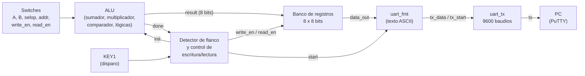

# Lab04 - ALU, banco registro y UART

# Integrantes
* [Sergio Luis Sandoval Briceño](https://github.com/chesan36) 
* [Kevinn ferney Mora Moreno](https://github.com/kevinfemoramo-gif) 
* [Kevin Steeven Blanco Montealegre](https://github.com/kevinstblancomo-gif) 
# Informe

Indice:

1. [Documentación](#documentación-del-diseño-implementado)
2. [Simulaciones](#simulaciones)
3. [Evidencias de implementación](#evidencias-de-implementación)
4. [Conclusiones](#conclusiones)
5. [Referencias](#referencias)

## Documentación del diseño implementado
En este laboratorio el objetivo es construir una ALU de 4 bits, conectarla a un banco de registros donde se guardan los resultados de las operaciones y poder ver lo que hay guardado en cada registro desde el computador usando el protocolo UART.
Todo el sistema se describió en verilog, se verificó en simulación con iverilog y GTKWave y después se implementó en la FPGA DE10-Lite, usando los switches para ingresar los datos y una terminal serial (PuTTY) para ver los resultados.

**Funcionamiento general del sistema**

El sistema tiene tres partes principales:

*La ALU, que hace la operación que se escoja entre las entradas A y B.

*El banco de registros, que guarda el resultado de la ALU en una de sus 8 direcciones.

*El bloque de UART, que lee un registro del banco y lo envía al PC como texto.

El usuario ingresa A, B, la operación (selop) y la dirección (addr) con los switches. Con el switch de escritura activo y oprimiendo KEY1, el resultado de la ALU se guarda en la dirección escogida. Con el switch de lectura activo y oprimiendo KEY1, el registro de esa dirección se envía por UART y en la terminal aparece una línea de la forma `dirección:valor`, por ejemplo `3:143`.

#### 1.1 Descripción de los módulos

**ALU (ALU.v)**

La ALU recibe dos operandos de 4 bits (A y B) y un selector de operación de 3 bits (selop). Entrega un resultado de 8 bits y una bandera (flag) que se pone en 1 cuando el resultado es cero. Las operaciones son:

| selop | Operación | Resultado |
|:-----:|:----------|:----------|
| 000 | Suma | A + B (4 bits) |
| 001 | Resta | A - B en complemento a 2 (4 bits) |
| 010 | Multiplicación | A * B (8 bits, secuencial) |
| 011 | Comparador | El mayor entre A y B |
| 100 | Corrimiento | A >> B |
| 101 | AND | A & B |
| 110 | OR | A \| B |
| 111 | XOR | A ^ B |

La suma y la resta se hacen con el mismo sumador/restador, la multiplicación usa el multiplicador secuencial del laboratorio 3 (ahora de 4 bits) y el comparador usa el módulo parcial. Las demás operaciones son combinacionales y se escriben directamente con los operadores de verilog. Un `case` sobre selop escoge cuál de todos los resultados sale por `result`. La entrada Cin quedó reservada y no se usa.

**Sumador/restador (sumador_restador_4b.v y sumador_1b.v)**

El sumador de 4 bits está hecho con 4 sumadores completos de 1 bit conectados en cascada (el carry de uno entra al siguiente). Para restar se usa el complemento a 2: cuando sel = 1, cada bit de B pasa por una XOR con sel (o sea se invierte) y ese mismo sel entra como carry inicial, así queda A + (~B + 1) = A - B. Si el resultado es negativo se ve en módulo 16, por ejemplo 3 - 9 da 10.

El sumador de 1 bit implementa las ecuaciones:

-s = a ⊕ b ⊕ cin

-cout = a·b + a·cin + b·cin

**Comparador (parcial.v y comparador_1b.v)**

El comparador de 1 bit entrega tres salidas: Ma (A > B), Mb (A < B) e i (A = B). En parcial.v se usan 4 de estos comparadores, uno por bit, y se combinan empezando por el bit más significativo: A es mayor si su bit 3 es mayor, o si los bits 3 son iguales y el bit 2 es mayor, y así hasta el bit 0. Con MA, MB e I se escoge la salida, que es el número mayor (si son iguales sale A).

**Multiplicador (multiplicador_fsm.v)**

Es el multiplicador secuencial del laboratorio 3 por sumas y desplazamientos, ampliado a 4 bits por 4 bits con producto de 8 bits. Tiene la misma máquina de estados (START, CHECK, ADD, SHIFT y END) y las mismas señales de control. La señal init arranca la multiplicación y done indica que el producto ya está listo. Desde el estado END se puede volver a iniciar otra multiplicación directamente con init, sin tener que pasar por reset.

**Banco de registros (banco_registro.v)**

Son 8 registros de 8 bits, direccionados con 3 bits (addr). La escritura es síncrona: en el flanco de subida del reloj, si write_en = 1 el dato de entrada (el resultado de la ALU) se guarda en el registro de la dirección addr. La lectura también es síncrona: si read_en = 1, el registro de esa dirección se copia en data_out. Con reset todos los registros quedan en cero.

**Formateador ASCII (uart_fmt.v)**

Este módulo convierte la dirección y el dato leído en texto para poder leerlo en la terminal. Envía 7 caracteres: el número de la dirección, dos puntos, el valor en decimal con 3 dígitos (centenas, decenas y unidades) y el salto de línea (CR y LF). Por ejemplo, dirección 3 con valor 143 se envía como `3:143`.

Funciona con una máquina de estados de 3 estados:

*IDLE: espera el pulso start, y cuando llega guarda la dirección y el dato.

*SEND: le da a la UART la orden de enviar el carácter actual (tx_start = 1).

*WAIT: espera a que la UART termine de enviar el carácter. Si ya se enviaron los 7 vuelve a IDLE, si no pasa al siguiente carácter y vuelve a SEND.

**Transmisor UART (uart_tx.v)**

Envía un byte por el pin tx a 9600 baudios, con el formato 8N1 (8 bits de datos, sin paridad y 1 bit de parada). Como el reloj es de 50 MHz, cada bit dura 50 000 000 / 9600 ≈ 5208 ciclos de reloj, que es lo que cuenta clk_cnt. La máquina de estados tiene 4 estados:

*IDLE: la línea está en 1. Cuando llega tx_start guarda el byte y pasa a START.

*START: pone la línea en 0 durante un bit (bit de inicio).

*DATA: envía los 8 bits empezando por el menos significativo.

*STOP: pone la línea en 1 durante un bit (bit de parada) y vuelve a IDLE.

Mientras está transmitiendo, tx_busy está en 1.

**Módulo top (top_system.v)**

Es el que une todo. Además de instanciar los módulos hace lo siguiente:

-Invierte KEY[0] y KEY[1], porque los botones de la tarjeta son activos en bajo. KEY[0] es el reset y KEY[1] el botón de disparo.

-Pasa el botón por dos flip-flops (btn_d1 y btn_d2) y genera un pulso de un solo ciclo (btn_pulse) en el flanco de subida. Así cada vez que se oprime el botón se hace una sola escritura o lectura, aunque se mantenga oprimido.

-Si la operación es una suma, resta o lógica, la escritura se hace en el mismo pulso del botón. Si es multiplicación, el pulso arranca el multiplicador y se activa la bandera pending_mult_wr, que espera a que done suba para escribir el producto en el banco.

-Como el banco entrega el dato leído un ciclo después de la orden, la señal de lectura se retrasa un ciclo (read_d) antes de arrancar el formateador.

-Muestra en los LED la bandera de cero (LEDR0), el done del multiplicador (LEDR1) y si la UART está ocupada enviando (LEDR2).

#### 1.2 Diagramas

Diagrama de bloques del sistema.



> **[Imagen]** Pegar aquí la captura del RTL Viewer de Quartus del módulo top_system.

> **[Imagen]** Pegar aquí la captura del RTL de la ALU.

#### 1.3 Asignación de pines

| Señal | Pin | En la tarjeta |
|:------|:---:|:--------------|
| clk | PIN_P11 | Reloj de 50 MHz |
| KEY[0] | PIN_B8 | Reset |
| KEY[1] | PIN_A7 | Disparo (escribir o leer) |
| ext_A[3:0] | C10, C11, D12, C12 | SW0 a SW3 |
| ext_B[3:0] | A12, B12, A13, A14 | SW4 a SW7 |
| ext_write_en | PIN_B14 | SW8 |
| ext_read_en | PIN_F15 | SW9 |
| ext_selop[2:0] | W10, V9, W9 | GPIO |
| ext_addr[2:0] | V8, W8, V7 | GPIO |
| tx | PIN_V10 | GPIO, va al RX del adaptador USB-serial |
| LEDR[2:0] | A8, A9, A10 | flag, done y UART ocupada |

## Simulaciones 

Se hicieron dos testbench.

**tb_ALU.v:** prueba la ALU sola de forma exhaustiva. Recorre las 8 operaciones con todas las combinaciones de A y B (8 x 16 x 16 = 2048 casos) y compara el resultado y la bandera con el valor esperado calculado en el mismo testbench. En la multiplicación el testbench da el pulso de init y espera a que suba done antes de comparar. Resultado:

```
 Casos probados totales :        2048
 Total de errores       :           0
 RESULTADO: >>> LA ALU PASO EL 100% DE LAS PRUEBAS <<<
```

**tb_top.v:** prueba el sistema completo como se usaría en la tarjeta. Para cada operación pone los valores en los switches, oprime el botón con write_en para guardar el resultado, después oprime el botón con read_en y recibe por el pin tx los 7 caracteres que manda la UART, para compararlos con la línea esperada. Al final vuelve a leer la dirección 3 sin escribir nada, para comprobar que el banco conserva el producto 143. En simulación la UART se pone a 1 Mbaud para que no tarde tanto (en la tarjeta es 9600). Resultado:

```
op=000 A=5 B=3  [OK]    UART -> "0:008" (addr=0, valor=8)
op=001 A=9 B=4  [OK]    UART -> "1:005" (addr=1, valor=5)
op=001 A=3 B=9  [OK]    UART -> "2:010" (addr=2, valor=10)
op=010 A=13 B=11  [OK]    UART -> "3:143" (addr=3, valor=143)
op=010 A=15 B=15  [OK]    UART -> "4:225" (addr=4, valor=225)
op=011 A=7 B=12  [OK]    UART -> "5:012" (addr=5, valor=12)
op=100 A=8 B=2  [OK]    UART -> "6:002" (addr=6, valor=2)
op=101 A=12 B=10  [OK]    UART -> "7:008" (addr=7, valor=8)
op=110 A=12 B=10  [OK]    UART -> "0:014" (addr=0, valor=14)
op=111 A=12 B=10  [OK]    UART -> "1:006" (addr=1, valor=6)
[OK]    UART -> "3:143" (addr=3, valor=143)
TOTAL ERRORES: 0
```

Se puede ver que la resta 3 - 9 da 10, que es -6 en módulo 16, y que las dos multiplicaciones seguidas (143 y 225) funcionan sin tener que resetear el multiplicador.

Los comandos para correr las simulaciones son:

```
iverilog -o sim_alu -f files.f
vvp sim_alu
iverilog -o sim_top -f files_top.f
vvp sim_top
gtkwave tb_top.vcd
```

> **[Imagen]** Pegar aquí la captura de GTKWave de tb_ALU.

Simulación en GTKwave de la ALU.

> **[Imagen]** Pegar aquí la captura de GTKWave de tb_top (escritura en el banco y la señal tx).

Simulación en GTKwave del sistema completo.

## Evidencias de implementación

Para probar en la tarjeta:

1. Se conecta el pin tx (PIN_V10) al RX de un adaptador USB-serial y la tierra del adaptador a un GND de la tarjeta.
2. Se abre PuTTY en el puerto COM del adaptador a 9600 baudios, 8 bits de datos, sin paridad, 1 bit de parada y sin control de flujo.
3. Se ponen A, B, la operación y la dirección en los switches, se activa write_en y se oprime KEY1 para guardar el resultado.
4. Se desactiva write_en, se activa read_en y se oprime KEY1. En PuTTY aparece la dirección y el valor guardado.

> **[Imagen]** Pegar aquí la foto de la tarjeta con los switches configurados.

> **[Imagen]** Pegar aquí la captura de PuTTY con los resultados.

## Conclusiones
En este laboratorio se logró integrar una ALU de 4 bits con un banco de registros y un transmisor UART, que son bloques básicos de un procesador. La ALU reúne operaciones combinacionales, que dan el resultado en el mismo ciclo, con la multiplicación secuencial del laboratorio anterior, y por eso fue necesario esperar la señal done antes de guardar el producto en el banco. El banco de registros permitió guardar varios resultados y volver a leerlos después, y la UART junto con el formateador ASCII permitió ver esos datos en el PC sin necesidad de displays. La simulación exhaustiva de la ALU (2048 casos sin errores) y la del sistema completo nos dieron confianza en el diseño antes de pasarlo a la FPGA. Este laboratorio deja listos los bloques que se van a controlar con la unidad de control en el siguiente laboratorio.

## Referencias
[1] "Lab04: ALU, banco registro y UART," guía de laboratorio, Arquitectura de Procesadores.

[2] "Lab03: Multiplicador secuencial," guía de laboratorio, Arquitectura de Procesadores.
