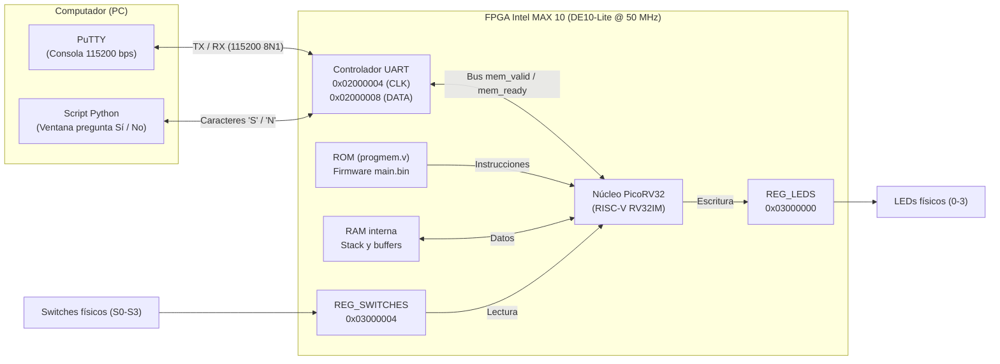

# Lab06 - Primer paso con PicoSoC y PicoRV32

# Integrantes
- [Sergio Luis Sandoval Briceño](https://github.com/chesan36)
- [Kevinn Ferney Mora Moreno](https://github.com/kevinfemoramo-gif)
- [Kevin Steeven Blanco Montealegre](https://github.com/kevinstblancomo-gif)

# Informe

Índice:

1. [Documentación del diseño implementado](#documentación-del-diseño-implementado)
2. [Compilación cruzada y síntesis](#compilación-cruzada-y-síntesis)
3. [Evidencias de implementación](#evidencias-de-implementación)
4. [Conclusiones](#conclusiones)
5. [Referencias](#referencias)

## Documentación del diseño implementado

En este laboratorio se implementó un *System on Chip* (SoC) basado en el núcleo RISC-V de 32 bits **PicoRV32** sobre la FPGA Intel MAX 10 (tarjeta DE10-Lite, reloj de 50 MHz). A diferencia de los laboratorios anteriores, donde la lógica de control se describía completamente en hardware mediante máquinas de estados en Verilog, en esta práctica el hardware conforma una plataforma programable (procesador, memoria de programa, memoria RAM y periféricos mapeados en memoria) sobre la cual se ejecuta un *firmware* escrito en C (`main.c`) y compilado de forma cruzada para arquitectura RV32IM.

**Funcionamiento general del sistema**

Al encender o reiniciar la tarjeta, el núcleo PicoRV32 comienza a ejecutar el firmware embebido en la memoria ROM (`progmem.v`). El programa inicializa el divisor de reloj de la UART a 115200 baudios, apaga los LEDs y presenta una consola interactiva (*shell*) accesible desde el PC mediante PuTTY. Desde el prompt (`> `), el usuario escribe comandos que el procesador interpreta para controlar los LEDs, leer los switches, realizar operaciones aritméticas o activar el modo interactivo con PC (`pregunta`).

#### 1.1 Arquitectura del PicoSoC y mapa de memoria

El SoC sintetizado integra cinco bloques principales interconectados mediante la interfaz de memoria tipo *handshake* (`mem_valid` / `mem_ready`) del PicoRV32:

- **Núcleo PicoRV32**: procesador RISC-V de 32 bits configurado para ejecutar instrucciones enteras y de multiplicación/división (`rv32im`).
- **Memoria ROM (`progmem.v`)**: almacena el código máquina del firmware generado a partir de `main.bin` en forma de tabla de inicialización en Verilog.
- **Memoria RAM**: almacena variables locales, la pila (*stack*) y los buffers de lectura de comandos.
- **Controlador UART**: gestiona la comunicación serial asíncrona full-duplex con el PC a 115200 baudios (8N1).
- **Periféricos GPIO**: registros mapeados en memoria para escribir en los 4 LEDs y leer el estado de los 4 switches físicos de la tarjeta.

Los periféricos se acceden desde C mediante punteros `volatile uint32_t *` a las siguientes direcciones del mapa de memoria:

| Periférico / Registro | Dirección | Acceso | Descripción |
|:----------------------|:---------:|:------:|:------------|
| `REG_UART_CLK` | `0x02000004` | W | Divisor de reloj de la UART (`CLK_FREQ / BAUD_RATE = 50000000 / 115200 ≈ 434`). |
| `REG_UART_DATA` | `0x02000008` | R / W | Escritura: transmite un byte por TX. Lectura no bloqueante: retorna el byte recibido por RX o un valor negativo si no hay dato disponible. |
| `REG_LEDS` | `0x03000000` | W | Controla los 4 LEDs de salida (bits `[3:0]`). |
| `REG_SWITCHES` | `0x03000004` | R | Lee el estado lógico actual de los 4 switches de entrada (`S3` a `S0` en bits `[3:0]`). |

#### 1.2 Estructura del firmware (`main.c`)

El firmware cargado sobre el PicoSoC se ejecuta en *bare-metal* (sin sistema operativo ni biblioteca estándar completa de C, únicamente `<stdint.h>`). Está organizado en cinco capas:

**Capa de abstracción de hardware (HAL)**

Encapsula el acceso directo a los registros mapeados en memoria mediante cuatro funciones base: `uart_putchar(char c)`, `uart_getchar_nb(void)`, `write_leds(uint32_t v)` y `read_switches(void)`.

**Utilidades UART y manejo de cadenas**

Como no se utiliza `stdio.h` ni `string.h` para mantener el binario compacto dentro de la ROM de la FPGA, el firmware implementa sus propias rutinas:

- `uart_getchar()`: realiza espera activa (*polling*) sobre `uart_getchar_nb()` hasta recibir un carácter válido.
- `uart_puts()`, `uart_crlf()`, `uart_put_dec()` y `uart_put_hex()`: envían cadenas, saltos de línea, enteros decimales con signo y valores hexadecimales de 8 bits por UART.
- `str_eq()`, `parse_int()` y `tokenize()`: comparan cadenas, convierten argumentos numéricos validando errores de formato y dividen la línea ingresada en hasta 8 tokens (`argv[]`).
- `delay_cycles(uint32_t n)`: genera retardos por software usando un contador `volatile` para evitar que el compilador optimice y elimine el ciclo.

**Intérprete de comandos (*Shell*)**

- `readline()`: lee caracteres desde la UART con eco hacia la terminal, soporta borrado con *Backspace* (`0x08` / `0x7F`) y finaliza la captura al recibir `\r` o `\n`, usando un buffer de 64 bytes.
- `shell_exec()`: tokeniza la entrada y despacha la ejecución al comando correspondiente.

**Comandos implementados**

| Comando | Sintaxis | Funcionamiento |
|:--------|:---------|:---------------|
| `help` | `help` | Lista en pantalla todos los comandos disponibles en el shell. |
| `about` | `about` | Muestra la versión del shell y la plataforma (`picoSoC Shell v1.0 - RISC-V PicoRV32 @ DE10-Lite`). |
| `clear` | `clear` | Envía la secuencia de escape ANSI `\x1b[2J\x1b[H` para limpiar la terminal. |
| `led` | `led <n> <on\|off>` | Enciende o apaga individualmente el LED `n` (rango `0` a `3`) actualizando la variable de estado `led_state`. |
| `leds` | `leds <valor>` | Asigna en paralelo los 4 LEDs aceptando valores en decimal (`0`–`15`) o hexadecimal (`0x0`–`0xF`) y confirma el valor en formato hexadecimal. |
| `sw` | `sw` | Lee `REG_SWITCHES` y muestra el estado en hexadecimal junto con el detalle individual de cada switch (`S3` a `S0`). |
| `blink` | `blink <n> <veces>` | Parpadea el LED `n` (`0`–`3`) entre `1` y `20` veces alternando su bit en `led_state` con un retardo de `200000` ciclos por estado. |
| `calc` | `calc <a> <op> <b>` | Realiza operaciones enteras (`+`, `-`, `*`, `/`) entre dos operandos, con validación de números, operador y protección contra división por cero. |
| `pregunta` | `pregunta` | Comando propio del grupo. Activa el modo interactivo con PC para sincronizar la FPGA con una aplicación gráfica en Python por UART. |

#### 1.3 Modificaciones realizadas sobre el `main.c` original

A partir del archivo `main.c` base del proyecto, se realizaron cuatro modificaciones puntuales para incorporar el comando creativo del grupo y optimizar el uso de memoria en la ROM generada (`progmem.v`):

1. **Implementación del comando propio `cmd_pregunta()`**:
   La idea del grupo consistió en integrar el procesador embebido con una aplicación de escritorio en Python que muestra una ventana con la pregunta *"¿Profe nos va a calificar con 50?"* y dos botones: **"Sí"** y **"No"**. Cuando el cursor intenta acercarse o dar clic en **"No"**, el botón/ventana huye por la pantalla y el script envía el carácter `'N'` por el puerto serial; cuando finalmente se presiona **"Sí"**, el script envía el carácter `'S'`.

   Para soportar esta interacción en el firmware:
   - Al ejecutar `pregunta`, el PicoRV32 imprime las instrucciones de uso (`== MODO PC ==`), apaga temporalmente los LEDs y entra en un bucle de escucha no bloqueante con `uart_getchar_nb()`.
   - **Recepción de `'N'` o `'n'`**: genera un patrón rápido de "burla" alternando los LEDs pares (`0x5`, LEDs 0 y 2) y los impares (`0xA`, LEDs 1 y 3) con retardos de `50000` ciclos antes de apagarlos.
   - **Recepción de `'S'` o `'s'`**: responde `"Aprobado!\r\n"` por UART, realiza una secuencia de celebración parpadeando los 4 LEDs (`0xF` / `0x0`) 6 veces con retardos de `150000` ciclos, restaura el `led_state` previo y regresa al prompt `>`.
   - **Salida física de emergencia**: en cada iteración del bucle se monitorea el switch más significativo (`read_switches() & 8`, correspondiente a `S3`). Al subirlo, se aplica un retardo antirrebote (`200000` ciclos), se restauran los LEDs y se retorna al shell imprimiendo `"Saliendo..."`.

2. **Registro del comando en `shell_exec()`**:
   Se añadió la condición `else if (str_eq(argv[0], "pregunta")) cmd_pregunta();` en el despachador principal de comandos.

3. **Compactación de cadenas en `cmd_help()`**:
   Se redujo la longitud de los mensajes descriptivos de ayuda y se agregó la entrada `pregunta (modo PC)`. Al reducir texto literal se disminuye el tamaño de la sección `.rodata` del binario, asegurando que el firmware ajustado quepa sin problemas en la memoria ROM sintetizada (`progmem.v`).

4. **Optimización de memoria en `uart_put_hex()`**:
   En el `main.c` original, la tabla de conversión estaba declarada como `const char hex[] = "0123456789ABCDEF";` (arreglo local en la pila). Se cambió a `static const char hex[]` para almacenarla una sola vez en memoria de solo lectura y evitar copiar la tabla en el *stack* en cada llamada.

#### 1.4 Diagrama de bloques



## Compilación cruzada y síntesis

El proyecto se construyó utilizando el entorno **MSYS2 MinGW 64-bit**, el *toolchain* de compilación cruzada **RISC-V (`riscv-none-elf-gcc`)** con arquitectura `-march=rv32im -mabi=ilp32` y la línea de comandos de **Intel Quartus Prime Lite** a través del `Makefile` del repositorio `picoSoC_simple`.

Los comandos ejecutados para el flujo completo de compilación, generación de ROM, síntesis y carga en la FPGA fueron:

```bash
# 1. Compilar firmware/main.c para RISC-V y generar main.bin y progmem.v
make

# 2. Ejecutar síntesis, ajuste de pines/recursos y generación del bitstream (.sof)
make build TARGET=max10

# 3. Programar la FPGA DE10-Lite (MAX 10)
make program TARGET=max10

# 4. Abrir el proyecto en Quartus para inspeccionar el diagrama RTL (Tools -> Netlist Viewers -> RTL Viewer)
quartus --64bit top.qpf
```

## Evidencias de implementación

Para verificar el funcionamiento del sistema completo sobre la FPGA DE10-Lite:

1. Se carga el bitstream generado mediante `make program TARGET=max10`.
2. Se conecta el adaptador USB-serial a los pines UART de la tarjeta y se abre **PuTTY** en el puerto COM asignado, configurado a **115200 baudios**, 8 bits de datos, sin paridad, 1 bit de parada y sin control de flujo.
3. Al presionar reset en la tarjeta, aparece el banner `picoSoC Shell - Arquitectura 2026` y el prompt `> `.
4. Se prueban en consola los comandos obligatorios (`help`, `led 2 on`, `leds 0xA`, `sw`, `blink 0 5`, `calc 6 * 7`) comprobando la respuesta inmediata en los LEDs y en la terminal.
5. Se ejecuta el comando `pregunta`, se cierra PuTTY para liberar el puerto COM y se corre el script de Python en el PC:
   - Al intentar mover el cursor sobre **"No"**, el botón escapa y los LEDs de la FPGA parpadean en patrón alternado (`0x5` / `0xA`).
   - Al presionar **"Sí"**, los 4 LEDs parpadean 6 veces celebrando la respuesta y el procesador vuelve automáticamente al prompt del shell.
   - Alternativamente, al subir el switch `S3`, el firmware sale de forma segura del modo PC y restaura el estado previo de los LEDs.

## Conclusiones

En este laboratorio se dio el salto del diseño digital puramente cableado a la implementación de un *System on Chip* completo basado en el procesador RISC-V PicoRV32 sobre la FPGA MAX 10. Integrar el núcleo junto con la ROM generada a partir de código C (`progmem.v`), memoria RAM y periféricos mapeados en memoria permitió comprobar cómo el software embebido en *bare-metal* controla directamente el hardware mediante lecturas y escrituras a direcciones específicas (`0x02000004`–`0x03000004`).

Además, la implementación de la consola interactiva por UART a 115200 baudios y del comando propio `pregunta` demostró la flexibilidad de una arquitectura programable: sin modificar el Verilog del procesador, fue posible añadir nuevas funcionalidades, optimizar el uso de ROM compactando cadenas y tablas estáticas, y establecer comunicación bidireccional en tiempo real entre una aplicación de escritorio en Python y los periféricos físicos de la FPGA.

## Referencias

[1] "Lab 06: Primer paso con PicoSoC y PicoRV32," guía de laboratorio, Arquitectura de Procesadores.

[2] YosysHQ, "PicoRV32 - A Size-Optimized RISC-V CPU," Repositorio GitHub. Disponible en: https://github.com/YosysHQ/picorv32

[3] Digital-ECCI, "picoSoC_simple," Repositorio GitHub. Disponible en: https://github.com/digital-ECCI/picoSoC_simple
[4] Google, "Gemini," asistente de inteligencia artificial (asistencia en formato Markdown), 2026. Disponible en: https://gemini.google.com
